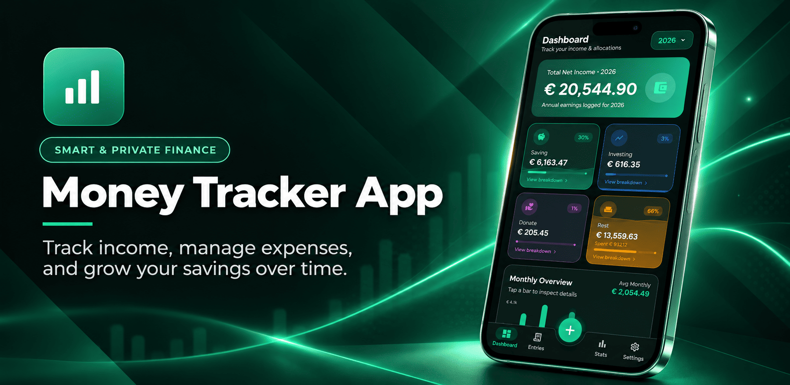

# 💰 Money Tracker Web

  
    
  

 

Official web landing page and companion site for **Money Tracker App** — a modern, privacy-first personal income, expense, and allocation manager Android application built with Jetpack Compose and Firebase.

> [!NOTE]
> This repository hosts the web landing page, legal privacy policy, and account data deletion portal for the Money Tracker ecosystem.

---

## ✨ Key App Features

- **💵 Fast Income & Expense Tracking**: Side-by-side recording of income and expenses with 12 pre-seeded smart taxonomies and nested sub-sources.
- **⚡ Dynamic Allocation & Emergency Fund**: Automatically splits income into Saving, Investing, Donate, and Rest with an interactive Emergency Fund tracker.
- **🧮 Inline Math Input**: Type arithmetic expressions (e.g. `(33+17)-10` or `1500 + 250`) directly into the amount field for instant calculation.
- **📊 Interactive Monthly Bar Chart**: 12-month calendar overview (Jan–Dec) with automatic peak earning (**Best Month**) and lowest earning (**Low Month**) badges.
- **🔄 Duplicate Detection & Auto-Merge**: Automatically detects repeat records in the same month/source and offers instant clean merges.
- **🔐 Guest Mode & One-Tap Google Sign-In**: Start tracking anonymously with zero setup, then seamlessly link to Google with automated data migration.
- **📈 All-Time Lifetime Statistics**: Multi-year totals, lifetime savings/investments/donations, recorded year averages, and net balance analysis.
- **🔒 Secure Cloud Sync & Offline Support**: Cloud Firestore offline persistence keeps your records available anywhere, syncing when back online.
- **📱 5-Slide Guided Onboarding & Dark Theme**: Polished first-launch intro walkthrough (Track, Tidy Up, Allocate, Understand, Control) and sleek Emerald Dark design.

---

## 🚀 Web Tech Stack

- **Structure**: Semantic HTML5 (Mobile-first responsive design)
- **Styling**: [Tailwind CSS](https://tailwindcss.com/) + Custom CSS for glassmorphism and bento-card layouts
- **Animations**: [GSAP](https://greensock.com/gsap/) & ScrollTrigger for smooth reveal-on-scroll effects
- **Interactivity**: Vanilla JavaScript for theme switching (Dark/Light screenshot switcher) and mobile menu navigation

---

## 🤝 Support the Mission

Money Tracker App is committed to remaining 100% ad-free. If this project helps you manage your finances, consider supporting its maintenance and future development:

- **International**: [Donate via Stripe](https://donate.stripe.com/3cI8wO6bWcqd7F46az8AE01)
- **Bangladesh**: bKash Send Money to `01773615582` (Personal)

---

## ⚖️ License

Distributed under the MIT License. See `LICENSE` for more information.

---

Built with ❤️ by [Sahed Alom Sumit](https://sahedalomsumit.com)
